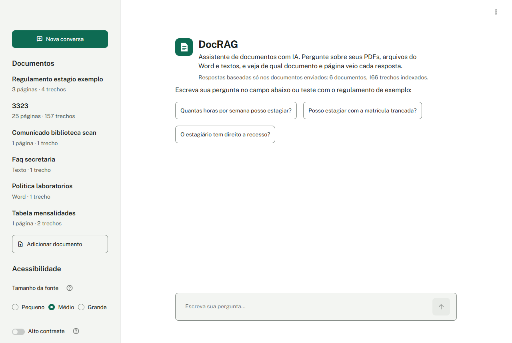
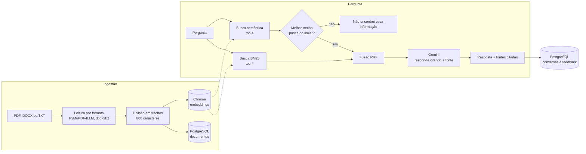
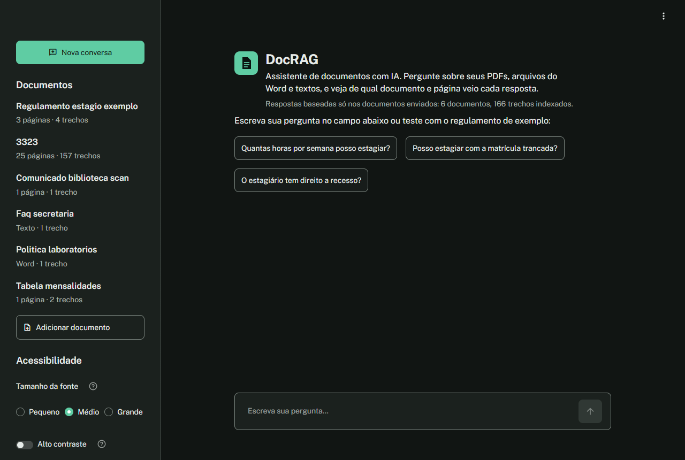
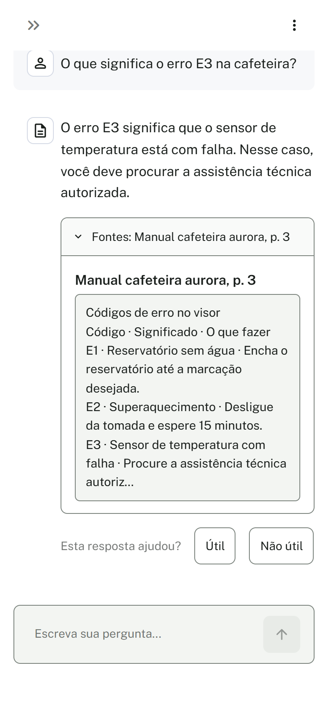

# DocRAG: assistente de documentos com RAG

[](https://github.com/Dev-AdryanSilva/docrag/actions/workflows/tests.yml)

Assistente que responde perguntas usando **só** os documentos enviados. Toda resposta cita o documento e a página de onde veio; quando a informação não está nos documentos, ele responde "Não encontrei essa informação nos documentos." em vez de inventar.



## O que ele faz

- **Lê vários formatos:** PDF (inclusive com tabelas e texto em duas colunas), PDF escaneado (com OCR em português), Word (`.docx`) e texto (`.txt`).
- **Busca híbrida:** combina busca por palavras exatas (BM25) com busca por significado (embeddings). Uma acha "E3" ou "rescisão" ao pé da letra; a outra entende "cancelar o contrato" quando o texto diz "encerrar".
- **Cita a fonte:** cada resposta mostra o documento, a página e o trecho usado.
- **Sabe dizer "não sei":** se nenhum trecho é parecido o bastante com a pergunta, responde sem nem chamar o LLM.
- **Conversa com memória:** perguntas de acompanhamento ("e se for antes da entrega?") levam em conta as trocas anteriores.
- **Feedback:** cada resposta pode ser marcada como útil ou não útil, e isso fica salvo no banco.

## Arquitetura



| Peça | Tecnologia | Por quê |
|---|---|---|
| API | FastAPI | Validação automática com Pydantic e documentação em `/docs` sem esforço |
| Interface | Streamlit | Interface de chat em Python puro; só conversa com a API por HTTP |
| Banco relacional | PostgreSQL + SQLAlchemy | Documentos, conversas, mensagens e feedback |
| Banco vetorial | Chroma | Roda local, sem servidor separado, e persiste em disco |
| Embeddings | `paraphrase-multilingual-MiniLM-L12-v2` | Modelo local e gratuito que funciona bem em português |
| LLM | Gemini Flash-Lite | Cota gratuita generosa; fica isolado em `app/llm.py` para ser trocado |
| Leitura de PDF | PyMuPDF4LLM | Converte o PDF em Markdown: tabelas viram tabelas e colunas saem na ordem certa |

## Decisões de projeto

**Por que busca híbrida?** Com só a busca semântica, um PDF grande (um edital de 157 trechos) dominava os resultados e perguntas com termos exatos, como "matrícula trancada", erravam. O BM25 resolve isso. As duas listas são juntadas por **Reciprocal Rank Fusion**: cada trecho ganha `1 / (60 + posição)` em cada lista onde aparece, então quem vai bem nas duas sobe. A vantagem é não precisar comparar notas de escalas diferentes.

**Por que um limiar de similaridade?** Se nem o trecho mais parecido passa de 0,25 de similaridade, a pergunta está fora do assunto dos documentos. Aí a API responde "não encontrei" direto, sem gastar uma chamada ao LLM. O limiar é baixo de propósito: barra só o que é claramente fora de assunto, e o prompt do LLM é a segunda barreira.

**Por que mostrar só as fontes citadas?** O LLM recebe 4 trechos, mas nem sempre usa todos. A API confere quais documentos e páginas aparecem na resposta e mostra só esses. Se o LLM não citar nada no formato esperado, mostra todos os trechos enviados, para nunca esconder a origem.

**Por que o LLM fica isolado?** Todo o contato com o Gemini está em `app/llm.py`, numa função `generate(messages) -> str`. Trocar por Groq, OpenAI ou um modelo local no Ollama é reescrever essa função; o resto do código não muda.

## Como rodar

### Com Docker (recomendado)

Precisa do Docker e de uma chave gratuita do Gemini, criada em https://aistudio.google.com/apikey.

```bash
cp .env.example .env    # depois, preencha GEMINI_API_KEY e API_KEY no .env
docker compose up --build
```

- Interface: http://localhost:8501
- API e documentação interativa: http://localhost:8000/docs

A primeira subida demora alguns minutos: ela baixa o PyTorch (versão só para CPU) e o modelo de embeddings.

Para ter documentos de exemplo, gere os arquivos e envie pela interface (**Adicionar documento**):

```bash
python scripts/generate_samples.py   # cria 3 exemplos em data/docs/
```

Os exemplos são fictícios e de áreas diferentes: um manual de cafeteira em PDF (com tabela de códigos de erro), uma política de trabalho remoto em Word e um contrato de serviço em TXT.

### Sem Docker (desenvolvimento)

Precisa do Python 3.12. Só o PostgreSQL roda no Docker:

```bash
python -m venv .venv
.venv\Scripts\activate          # no Linux/macOS: source .venv/bin/activate
pip install --extra-index-url https://download.pytorch.org/whl/cpu -r requirements-dev.txt

docker compose up -d postgres
uvicorn app.main:app                      # API em :8000
streamlit run ui/streamlit_app.py         # interface em :8501 (outro terminal)
```

Nesse modo, o OCR de PDFs escaneados só funciona com o [Tesseract](https://github.com/tesseract-ocr/tesseract) instalado no sistema. No Docker ele já vem incluído.

### Configuração

Todas as opções ficam no `.env` (veja o `.env.example`):

| Variável | Padrão | Para que serve |
|---|---|---|
| `GEMINI_API_KEY` | (obrigatória) | Chave do Gemini |
| `API_KEY` | (obrigatória) | Chave que protege as rotas de escrita (header `X-API-Key`) |
| `GEMINI_MODEL` | `gemini-3.1-flash-lite` | Modelo usado para responder |
| `TOP_K` | `4` | Quantos trechos cada busca devolve |
| `SIMILARITY_THRESHOLD` | `0.25` | Similaridade mínima para a pergunta ser respondida |
| `CHUNK_SIZE` / `CHUNK_OVERLAP` | `800` / `100` | Tamanho dos trechos e sobreposição entre eles |
| `HISTORY_TURNS` | `4` | Quantas trocas anteriores entram no prompt |

## Usando a API

As rotas que gravam dados ou gastam o LLM exigem o header `X-API-Key`. Nos exemplos, troque `sua-chave` pelo valor de `API_KEY` do seu `.env`.

**Enviar um documento**

```bash
curl -X POST http://localhost:8000/documentos \
  -H "X-API-Key: sua-chave" \
  -F "file=@data/docs/manual_cafeteira_aurora.pdf"
```

```json
{"id": 1, "filename": "manual_cafeteira_aurora.pdf", "num_pages": 3, "num_chunks": 3, "created_at": "2026-10-29T13:03:37Z"}
```

**Perguntar**

```bash
curl -X POST http://localhost:8000/perguntar \
  -H "X-API-Key: sua-chave" \
  -H "Content-Type: application/json" \
  -d '{"pergunta": "O que significa o erro E3 na cafeteira?"}'
```

```json
{
  "resposta": "O erro E3 significa que o sensor de temperatura está com falha. Nesse caso, você deve procurar a assistência técnica autorizada (manual_cafeteira_aurora.pdf, p. 3).",
  "fontes": [
    {"documento": "manual_cafeteira_aurora.pdf", "pagina": 3, "trecho": "# **Códigos de erro no visor** ..."}
  ],
  "conversation_id": 1,
  "mensagem_id": 2
}
```

**Continuar a conversa:** envie o `conversation_id` recebido.

```bash
curl -X POST http://localhost:8000/perguntar \
  -H "X-API-Key: sua-chave" \
  -H "Content-Type: application/json" \
  -d '{"pergunta": "E o erro E2?", "conversation_id": 1}'
```

**Avaliar uma resposta:** use o `mensagem_id` da resposta.

```bash
curl -X POST http://localhost:8000/feedback \
  -H "X-API-Key: sua-chave" \
  -H "Content-Type: application/json" \
  -d '{"mensagem_id": 2, "util": true}'
```

> No PowerShell, use `curl.exe` em vez de `curl` e troque as `\` do fim de linha por `` ` ``.

| Método | Rota | Chave? | O que faz |
|---|---|---|---|
| `GET` | `/health` | não | Verifica a API e o banco |
| `GET` | `/documentos` | não | Lista os documentos |
| `GET` | `/documentos/{id}` | não | Detalhes de um documento |
| `POST` | `/documentos` | sim | Envia PDF, DOCX ou TXT |
| `DELETE` | `/documentos/{id}` | sim | Remove o documento e os trechos dele |
| `POST` | `/perguntar` | sim | Faz uma pergunta |
| `GET` | `/conversas/{id}` | não | Histórico de uma conversa |
| `POST` | `/feedback` | sim | Marca uma resposta como útil ou não |

## Testes

```bash
pytest
```

São 35 testes que rodam em cerca de 1 segundo. Eles não chamam o Gemini, não carregam o modelo de embeddings e não precisam do PostgreSQL: o LLM e as buscas são trocados por versões falsas, e o banco vira um SQLite temporário. O GitHub Actions roda os testes a cada push e pull request.

| Arquivo | O que cobre |
|---|---|
| `tests/test_ingest.py` | Leitura de TXT (UTF-8 e Latin-1), DOCX e PDF; divisão em trechos; número da página |
| `tests/test_perguntar.py` | Limiar que evita chamar o LLM, fontes citadas, histórico da conversa, falha do LLM, feedback |
| `tests/test_auth.py` | Rotas protegidas recusam chave ausente ou errada; rotas públicas abertas; upload |
| `tests/test_rag.py` | Busca BM25, fusão RRF e verificação das citações |

Os testes já pegaram um bug real: uma resposta que citava "p. 10" fazia o sistema mostrar também a página 1 como fonte, porque "p. 1" está contido em "p. 10".

## Estrutura

```
app/
  main.py        rotas da API
  ingest.py      leitura dos formatos, divisão em trechos, Chroma e BM25
  rag.py         buscas, fusão, limiar, prompt e montagem das fontes
  llm.py         único ponto de contato com o Gemini
  crud.py        acesso ao banco
  models.py      tabelas (SQLAlchemy)
  schemas.py     formatos de entrada e saída (Pydantic)
  security.py    verificação da API key
  config.py      configurações lidas do .env
ui/
  streamlit_app.py   interface (só consome a API)
  styles.css         tema e acessibilidade
scripts/
  generate_samples.py   gera os documentos de exemplo
tests/                  testes com pytest
```

## Acessibilidade

A interface segue a WCAG 2.2 nível AA até onde o Streamlit permite.

- **Tema claro e escuro:** segue o tema do sistema. Para trocar, use o menu ⋮ no canto superior direito e escolha *Light* (claro), *Dark* (escuro) ou *System* (sistema).
- **Contraste:** todos os pares de cor têm pelo menos 4.5:1 para texto e 3:1 para bordas e componentes, nos dois temas. As cores ficam em `.streamlit/config.toml` e viram tokens em `ui/styles.css`.
- **Opções na barra lateral (seção "Acessibilidade"):**
  - tamanho da fonte (Pequeno, Médio, Grande);
  - alto contraste;
  - reduzir animações. A preferência do sistema (`prefers-reduced-motion`) também é respeitada.
- **Teclado:** tudo funciona sem mouse, com um contorno de foco sempre visível.
- **Textos claros:**
  - botões com texto, nunca só ícone;
  - erros escritos por extenso ("Erro: ..."), não indicados só pela cor;
  - página marcada como `pt-BR`.
- **Celular:** funciona a partir de 375px de largura, sem rolagem horizontal e com botões de pelo menos 44px de altura.

| Tema escuro | Celular |
|---|---|
|  |  |

## Limitações conhecidas

- **Uma chave para todos:** a API key protege as rotas de escrita, mas não há usuários separados. Todo mundo vê os mesmos documentos e conversas.
- **Índice BM25 em memória:** ele é refeito a partir do Chroma sempre que um documento entra ou sai. Funciona bem com centenas de trechos, mas não com milhões.
- **Sem avaliação automática da qualidade:** o limiar e o prompt foram calibrados com perguntas de teste feitas à mão, não com um conjunto de avaliação.
- **Cota do Gemini:** no plano gratuito há limite de requisições por dia, e o serviço às vezes fica sobrecarregado. Nesses casos a API responde com erro 502 em vez de travar.

## Como usei IA neste projeto

Desenvolvi o DocRAG com o **Claude Code** (assistente de programação da Anthropic) como par de programação.

**Como foi o processo:**
- Antes de escrever código, defini um plano em 7 etapas: esqueleto, banco, ingestão, RAG, interface, testes e documentação.
- A IA implementava uma etapa por vez e parava. Eu testava, validava e só então seguia para a próxima.
- No começo, os commits entravam direto na `main`. Na última etapa, passei a usar pull requests: a documentação entrou por PR, com os testes rodando no CI e minha revisão antes do merge.

**Decisões que tomei durante o projeto:**
- adotar a busca híbrida, depois de ver o edital grande dominando os resultados;
- transformar o projeto de um chatbot de regulamentos em um assistente de documentos genérico;
- investir em acessibilidade na interface;
- ajustes visuais que encontrei usando a interface, como um contorno de foco duplicado no campo de pergunta.

**Onde precisei conferir o que a IA fez:**
- **Modelos e cotas do Gemini:** o modelo planejado não estava disponível para contas novas, e outro tinha só 20 requisições por dia. Testamos as opções até chegar no Flash-Lite.
- **Dependência quebrada:** a versão 2.0 do PyMuPDF publicada no PyPI é um pacote vazio. Foi preciso fixar a versão 1.28.2.
- **Bug nas citações:** o bug da "p. 10" só apareceu quando escrevemos os testes. O código original parecia certo numa leitura rápida.
- **Ferramentas descontinuadas:** o `langchain-community`, usado no BM25, foi descontinuado. Trocamos pelo `rank-bm25` direto.
